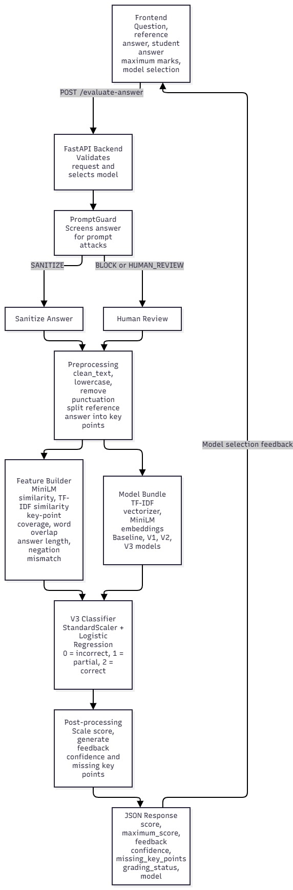

# AI Exam Answer Grader

An NLP-based short-answer grading system that compares a student's response
with an instructor's reference answer, predicts a grade band, and returns
explainable feedback.

The project provides:

- A browser-based frontend for submitting answers.
- A FastAPI backend for validation and inference.
- PromptGuard screening before grading.
- Four model versions: baseline, V1, V2, and V3.
- Key-point coverage analysis for missing-concept feedback.
- A reusable trained model bundle and evaluation reports.

## Architecture



## How grading works

1. The frontend submits the question, reference answer, student answer, and
   maximum marks to the API.
2. PromptGuard screens the student answer.
3. Blocked or suspicious answers are returned for human review.
4. Allowed or sanitized answers are cleaned and split into reference key
   points.
5. The feature builder combines:
   - MiniLM semantic similarity
   - TF-IDF similarity
   - Minimum key-point coverage
   - Word overlap
   - Answer and reference length
   - Negation mismatch
6. The selected classifier predicts one of three grade bands:
   - `0`: Incorrect
   - `1`: Partially correct
   - `2`: Correct
7. The predicted band is scaled to the question's maximum marks.
8. The API returns the score, confidence, feedback, and missing key points.

V3 is the default model. V2, V1, and the baseline remain available for
comparison through the API and command-line grader.

## Requirements

- Python 3.11 or newer
- [uv](https://docs.astral.sh/uv/)
- Internet access on the first run to download the MiniLM model
- A running local PromptGuard service for answer screening

## Installation

From the repository root:

```bash
cd backend
uv sync
```

The repository includes a trained model bundle at
[`backend/models/grader_models.joblib`](backend/models/grader_models.joblib).

## Run the application

### 1. Start PromptGuard

Start the local PromptGuard API on port `8001`, or configure a different
address:

```powershell
$env:PROMPTGUARD_URL = "http://127.0.0.1:8001"
```

The API uses a five-second PromptGuard timeout by default. Change it with:

```powershell
$env:PROMPTGUARD_TIMEOUT_SECONDS = "5"
```

### 2. Start the backend

From the `backend` directory:

```bash
uv run uvicorn api:app --app-dir src --reload
```

The backend runs at `http://127.0.0.1:8000`.

- Swagger UI: `http://127.0.0.1:8000/docs`
- ReDoc: `http://127.0.0.1:8000/redoc`
- Health check: `http://127.0.0.1:8000/health`

### 3. Start the frontend

From the repository root, in a second terminal:

```bash
python -m http.server 5500 --directory frontend
```

Open `http://127.0.0.1:5500` in a browser.

## API usage

### Request

`POST /evaluate-answer?model=v3`

```json
{
  "question": "Q4",
  "reference_answer": "Supervised learning uses labelled data to learn a mapping from inputs to outputs.",
  "marking_rubric": "Award full marks for identifying labelled training data and the learned mapping.",
  "student_answer": "It learns from labelled examples.",
  "maximum_marks": 5
}
```

The `model` query parameter accepts `v3`, `v2`, `v1`, or `baseline`. It defaults
to `v3`. The `marking_rubric` field is accepted for interface compatibility but
is not currently used by the model.

### Response

```json
{
  "question": "Q4",
  "score": 3,
  "maximum_score": 5,
  "feedback": "The answer is partially correct but misses some key concepts.",
  "confidence": 0.71,
  "missing_key_points": [],
  "model": "v3_improved",
  "grading_status": "graded",
  "promptguard": {
    "recommended_action": "ALLOW"
  }
}
```

For `BLOCK` or `HUMAN_REVIEW`, the response has no automatic score and uses
`"grading_status": "human_review"`.

## Command-line grader

From `backend`:

```bash
uv run python src/grade.py
```

To grade a custom answer in PowerShell:

```powershell
uv run python src/grade.py `
  --question "Q1" `
  --max-marks 5 `
  --reference "Supervised learning uses labelled data to learn a mapping from inputs to outputs." `
  --answer "It learns from labelled examples."
```

## Training and evaluation

The cleaned EngSAF train, validation, and test files are stored in
[`backend/data/`](backend/data/).

Regenerate the dataset:

```bash
cd backend/src
uv run python preprocessing.py
```

Train and compare the baseline, V1, and V2 models:

```bash
cd backend
uv run python src/compare_models.py
```

Train and evaluate the V3 improvement:

```bash
uv run python src/improve_model.py
```

The generated model bundle is saved to
[`backend/models/grader_models.joblib`](backend/models/grader_models.joblib).
Evaluation reports are written to [`backend/results/`](backend/results/).

## Current benchmark

Results from the stored EngSAF test split:

| Model | Accuracy | Macro-F1 | QWK | MAE | Partial recall |
| --- | ---: | ---: | ---: | ---: | ---: |
| V2 hybrid | 0.5257 | 0.5005 | 0.3643 | 0.5711 | 0.3770 |
| V3 improved | 0.5494 | 0.5252 | 0.3919 | 0.5415 | 0.4084 |

See [`backend/results/model_comparison_v3.md`](backend/results/model_comparison_v3.md)
for V3 selection details and
[`backend/results/model_comparison.md`](backend/results/model_comparison.md)
for the complete model comparison.

## Repository structure

```text
.
├── architecture.mmd             Mermaid architecture diagram
├── Architecture_diagram.jpg     Visual architecture diagram
├── backend/
│   ├── data/                    EngSAF dataset splits
│   ├── models/                  Trained model bundle
│   ├── notebooks/               Development notebooks
│   ├── results/                 Metrics and predictions
│   ├── src/
│   │   ├── api.py               FastAPI application
│   │   ├── features.py          Feature engineering
│   │   ├── grade.py             Inference pipeline and CLI
│   │   ├── improve_model.py     V3 training and selection
│   │   ├── preprocessing.py     Dataset cleaning
│   │   └── compare_models.py    Baseline/V1/V2 training
│   ├── pyproject.toml           Python dependencies
│   └── uv.lock                  Locked dependency versions
└── frontend/
    ├── index.html               Grading form and result view
    ├── app.js                   API integration
    └── styles.css               Frontend styling
```

## Limitations

- This is a three-class short-answer grader, not a generative feedback model.
- The marking rubric is accepted by the API but is not currently used in
  feature generation.
- PromptGuard must be available locally before answers can be graded.
- The first MiniLM load may take longer while the model is downloaded and
  cached.
- Model inference runs on CPU by default.
